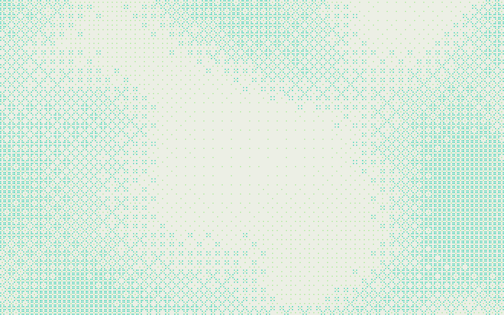

# Dither Field

An animated dithered ASCII texture for web page backgrounds. No dependencies, no build step, one file.



**[Tune it in your browser →](https://gnome00.github.io/dither-field/)** — the tuner: a page of sliders over a live texture, with a button that hands you the code for whatever you have tuned. `npm run serve` gives you the same page locally.

## Quick start

```html
<div style="position:relative; isolation:isolate; min-height:60vh">
  <div id="bg" style="position:absolute; inset:0; z-index:-1;
       --dither-layer-1:#80e862; --dither-layer-2:#2ad1b2"></div>
  <script type="module">
    import { createDitherField } from './dither-field.js';
    createDitherField(document.getElementById('bg'));
  </script>
</div>
```

The parent must be positioned and carry `isolation: isolate`, and the background needs `z-index: -1` — otherwise the texture paints over your own content. (Without `isolation`, the alternative is `position: relative; z-index: 1` on the content itself.) The tuner's export writes all of this for you.

## How it works

- The box is divided into a grid of cells, a few pixels each.
- A slowly moving field gives every cell a value, and an 8×8 ordered-dither (Bayer) threshold decides whether that cell gets a mark.
- Each layer has its own character, colour and threshold, so layers stack like inks in print.
- A **quiet zone** holds the texture back where your words go, so text stays readable.
- Every time term is periodic, so the loop returns exactly to where it began: no seam, no restart.

## Colours

Colours come from CSS custom properties on the host element, not from the options:

```css
#bg { --dither-layer-1: #80e862; --dither-layer-2: #2ad1b2; --dither-backdrop: transparent; }
```

One per layer, bottom first. Leave `--dither-backdrop` transparent to let whatever is behind show through.

## The quiet zone

The lighter area that keeps text legible. Put it where your words are:

```js
createDitherField(el, { quiet: { enabled: true, x: 50, y: 50, aspect: 1.6, softness: 0.9, strength: 0.8, irregularity: 0.35 } });
```

One centred zone is on by default. Its position and shape can also come from CSS — `--dither-quiet-x`, `-y`, `-size`, `-aspect`, all unitless — so it can move at a breakpoint without touching JavaScript. A CSS value wins over the option.

Its size comes from the width of the box rather than from `quiet.size`: `responsive.quietSize` is `[value at 320px wide, value at 1440px]`, 42 and 30 by default, blended in between. `responsive.patternSize` works the same way. The plain `quiet.size` (39) and `patternSize` (0.6) apply only when `responsive` is set to `null`.

Zones can instead follow your own elements, one per element, so the clear area tracks your text at every width. That is `anchorQuiet`, off by default and described in [`docs/api.md`](docs/api.md).

## Options worth knowing

| Option | Default | What it does |
| --- | --- | --- |
| `speed` | 1.9 | How fast the loop plays |
| `loopSeconds` | 60 | Length of one cycle at speed 1 |
| `fps` | 15 | Frame rate. 10–15 suits this texture and keeps laptops cool |
| `cellSize` | 9 | Smallest cell, in CSS pixels; cells grow on large screens |
| `glyphScale` | 1.6 | Mark size relative to its cell |
| `patternSize` | 1.15 → 0.63 | Bigger means larger, softer blobs. The pair comes from `responsive`, which overrides the plain `patternSize` of 0.6 unless you set `responsive: null` |
| `patternX` / `patternY` | 0 | Slide the texture across the box, as % of width and height |
| `contrast` | 1.25 | How hard the light and dark areas separate |
| `density` | 0.68 | Shifts the whole field lighter or darker, −1 to 1 |
| `overlap` | `'stack'` | `'stack'` lets layers overlap; `'single'` gives one mark per cell |
| `layerCount` | 2 | How many layers are drawn |
| `layers` | four, two drawn | Each: `glyph`, `threshold`, `opacity`, `timeOffset`, optional `fontWeight`. Entries past `layerCount` are spares; the tuner adds two more of its own, so its layer count goes to six |

[`docs/api.md`](docs/api.md) lists every option and the CSS contract; the range and effect of each sits beside its value in `DEFAULTS` at the top of [`dither-field.js`](dither-field.js).

## Built in, nothing to add

- Frame rate capped, and the animation pauses entirely while the tab is hidden.
- `prefers-reduced-motion` gets a single still frame rather than movement.
- The grid is capped at 8,000 cells by default; on large screens cells grow instead of multiplying.
- Resize is debounced; phone screens get sharper rendering, desktops stay at 2×.
- The canvas is `aria-hidden` and ignores pointer events.

## Browser support

Canvas 2D, ES modules, `ResizeObserver` and `matchMedia` — every current browser. If there is no 2D context, `createDitherField` returns `null` and whatever CSS background sits underneath simply stays. The automated tests run in Chrome only, because Firefox and Brave add noise to canvas pixel reads by design.

## Fonts

The two default marks are drawn as shapes, so the default look needs no font at all. If you choose your own characters, they are drawn in whatever monospace family you name in `fontFamily` — nothing is downloaded for you.

## Privacy

The tuner makes no network requests, enforced by a content security policy on the page itself and by a test in `test/tuner.test.mjs` that fails if any request leaves the origin. Your settings stay in your own browser, and nothing you type into the page leaves it.

The export's CDN option is the exception, and it is clearly marked: a snippet that loads the engine from jsDelivr means your visitors' browsers contact jsDelivr. The other two modes — host the file yourself, or paste the whole engine — involve nobody.

## Development

```sh
npm run serve    # the tuner at http://127.0.0.1:8765/
npm test         # unit tests plus a headless-Chrome suite
```

Needs Node 22 or newer. Tests drive Google Chrome, looked for at `/Applications/Google Chrome.app/Contents/MacOS/Google Chrome` on macOS and `/usr/bin/google-chrome` elsewhere; set `CHROME` to its path if yours is somewhere else. Run one file with `node --test test/engine.test.mjs`. There are no dependencies to install, and no lockfile.

| Path | What it is |
| --- | --- |
| `dither-field.js` | The engine. The only file a user of this project needs |
| `index.html`, `tuner/` | The tuner: markup, styles, panel, presets, and the export builders |
| `tuner/safe.js` | Escaping and validation for everything the export writes out |
| `examples/` | A minimal page, and an Astro wrapper offered as an example |
| `test/` | The suite: `*.test.mjs`, a static server, and a headless-Chrome driver |
| `docs/api.md` | The full option and CSS reference |

## Releasing

How this gets published and tagged is in [RELEASING.md](RELEASING.md). Outstanding work is in [BACKLOG.md](BACKLOG.md).

## Licence

MIT — see [LICENSE](LICENSE). Issues are welcome, and answered when time allows.
